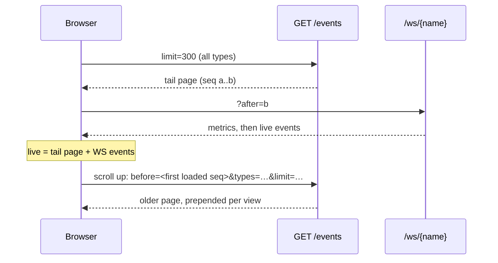

# Agent sidebar, paged history, virtualized views, trace cards — design

Status: draft for approval · 2026-11-12 · builds on `2026-11-10_telegram-files-profiles.md`

## 1. Intent

Fixes from day-to-day use with a long-running agent (`researcher`, 5.1 MB `events.jsonl`):

1. **Metrics** move out of the settings drawer and sit behind a button in the bottom-left corner.
2. **Agents live in a Telegram-style sidebar.**
   - "New agent" opens a creation window.
   - Each row has a horizontal ⋯ button that opens that agent's settings.
   - The settings let you change the agent's model.
3. **Responsive.**
   - The layout works on narrow and mobile screens.
   - Light animation makes the UI feel fluid.
4. **The trace must not lag (critical).**
   - Typing in the chatbox and switching to the trace must stay instant however big the log gets.
   - Each trace entry renders as a box (thinking, executing, notification, …).
5. **Chat history is paged.**
   - A fresh load shows only recent messages.
   - Scrolling up loads older ones in chunks.
6. **A taller chatbox.**

Root causes found in the current code:
- **Fresh load.** The WS replays the whole log from seq 0, and the browser keeps every event.
- **Typing.** Every keystroke re-renders `ChatView`, which re-runs `chatItems(events)` and re-parses the markdown of every message (nothing is memoized).
- **Event and metrics pushes.** Every flushed event batch and every metrics push re-renders `App`, and with it the active view.
- **Opening the trace.** `TraceView` mounts every event at once, with markdown and highlight.js.

## 2. Goals / non-goals / anti-goals

Goals
- **Fresh load.** The browser downloads one bounded tail page plus live events, not the whole log.
- **Scrolling up.** Chat and trace fetch older pages from the server and prepend them without the view jumping.
- **Bounded rendering.**
  - Chat and trace only mount the rows near the viewport.
  - A keystroke re-renders only the composer.
  - Live events re-render only rows that changed, plus the new rows.
- **Trace cards.**
  - Thinking, executing (code + output), notification, message, sent, job, context edit and error each render as a card.
  - The current agent state shows as a live card at the bottom.
- **Agent list.**
  - A sidebar lists the agents.
  - A creation window makes new ones.
  - Each agent has a settings window: info, change model, delete.
- **Layout.**
  - Three layouts by width: wide, compact rail, mobile single pane.
  - CSS transitions everywhere they help.
- **Composer.** It starts at 3 lines and grows up to about 40% of the viewport.

Non-goals
- Renaming agents, or per-agent budget, timeout or `SUB_MODEL`.
- Search in chat or trace.
- Unread badges.
- Changing what the backend writes to `events.jsonl`, or its format.

Anti-goals
- Anything that rewrites, migrates or deletes existing agent data. The only write this design adds is the `model` key in `profile.json`, made from the settings window on request.
- Scroll glitches: losing the bottom-follow, or the view jumping when older pages prepend or images load late.
- An interrupted agent at deploy time. Deploy only while the agent is idle.
- Animation that delays interaction, or that runs under `prefers-reduced-motion: reduce`.

## 3. Constraints

- Existing stack and conventions:
  - FastAPI backend, React 19 + Vite + TS frontend, docker compose on the remote host.
  - TDD, minimal code, no sub-agents, no auto-commit.
- **Frontend dependency.** One new dependency, `react-virtuoso` (chosen by the user). No animation library or icon library.
- **Data on disk.** `events.jsonl` is append-only, holds one JSON object per line, and has strictly increasing `seq`.
- **Deploy restarts the backend.** A backend change means a rebuild and restart.
  - On restart, the context comes back from `context.md` and live jobs are adopted (`Executor.startup`).
  - An in-flight model call or foreground run would be cut. The agent is idle now (confirmed by the user).

## 4. Approaches

| Area | Approach | Trade-off | Outcome |
|---|---|---|---|
| history loading | **A. Server pages**: a REST page endpoint plus the WS from the tail | Fixes download and memory at the root. Needs a small, read-only backend change | **Chosen** |
| | B. Browser only: download everything, render only the tail | No backend change, but load time and memory keep growing with the log | Rejected |
| rendering | **1. `react-virtuoso`** + memoized rows + isolated composer state | Prepend anchoring, bottom-follow and dynamic heights are solved. One dependency (~15 KB gz) | **Chosen** |
| | 2. Hand-rolled: memo + `content-visibility` + manual scroll anchoring | No dependency, but late images and prepend anchoring are a known bug class here | Rejected |
| | 3. Paging + memo only | Least code, but a long live session lags again | Rejected |
| agent settings | **B. View + change model + delete** | One more backend route, and the model applies at the next model call | **Chosen** |
| | A. View + delete only | No backend change | Rejected |

## 5. File tree (overview of changes)

```
clm-harness/
├── specs/
│   └── 2026-11-12_sidebar-paging-trace-cards.md   # this document
├── backend/
│   ├── src/backend/
│   │   ├── events.py         # + Events.page(before, limit, types): read-only page of events.jsonl
│   │   ├── profiles.py       # + Profiles.set_model(name, model): rewrite profile.json model key, swap model
│   │   └── app.py            # + GET /api/p/{name}/events, + PATCH /api/profiles/{name}
│   └── tests/
│       ├── test_events_notify.py   # page(): order, before, limit, types, more, opened
│       └── test_app.py             # GET events route, PATCH profile route (404/422, file kept, next call uses new model)
└── frontend/
    ├── package.json          # + react-virtuoso
    └── src/
        ├── App.tsx           # grid: Sidebar | agent pane; header with name/state/tabs; dialogs; hotkeys; mobile pane
        ├── Sidebar.tsx       # NEW: agent rows (avatar, name, model, state, ⋯), + New agent, bottom bar (metrics popover, theme)
        ├── Dialogs.tsx       # NEW: Modal shell, NewAgent window, AgentSettings window, ModelInput, DeleteConfirm
        ├── SettingsPanel.tsx # DELETED (split into Sidebar.tsx + Dialogs.tsx; MetricsTable moves to Sidebar.tsx)
        ├── ws.ts             # useEvents: seed tail page then WS ?after=; + useHistory(profile, types, live) paging hook
        ├── ChatView.tsx      # Virtuoso list, memo Item, Composer component (own state), taller textarea
        ├── TraceView.tsx     # Virtuoso list of memo cards, live state card, Stop
        ├── ContextView.tsx   # context edits from REST history + live, instead of the full event array
        ├── derive.ts         # + traceCards(events), + opened-set helper; chatItems takes opened ids
        ├── derive.test.ts    # traceCards grouping, opened merge
        └── theme.css         # sidebar, agent header, cards, modals, popover, breakpoints, transitions
```

## 6. Design

### 6.1 Backend: paged events (read-only)

`Events.page(before: int | None, limit: int, types: set[str] | None) -> dict`
- Reads `events.jsonl` (same `read_jsonl` as `since`).
- Keeps rows with `seq < before` (all rows when `before` is None), filtered by `types` when given.
- Returns the last `limit` of them in ascending `seq` order, as `{"events": [...], "more": <older matching rows exist>}`.
- `user_message` rows get `opened: bool`. That is true when any `message_opened` with the same `id` exists anywhere in the file.
- It never writes.

Route: `GET /api/p/{name}/events?before=&limit=&types=`
- `limit` defaults to 200 and is clamped to 1..1000.
- `types` is a comma-separated list.
- An unknown profile returns 404 (`profiles.get`).

Cost: the whole file is parsed per request, about 5 MB today. That's acceptable at this size. `since()` already does the same on every WS connect.

The WS `/ws/{name}?after=` is unchanged.

### 6.2 Backend: change model

`Profiles.set_model(name, model)`:
1. `r = self.get(name)`, which returns 404 for an unknown agent.
2. Read `profile.json` and write `{**old, "model": model}` with `harness.write_json`. `created` and any other keys are kept.
3. Set `r.model = model`, `r.agent.model = r.model_factory(model)` and `r.agent.model_name = model`.

Effect:
- An in-flight `ainvoke` keeps its reference to the old model and finishes on it. The next model call uses the new model.
- Context, event log, jobs, files and metrics are untouched.
- Pricing follows `model_name`, so it is unpriced unless the model is in `PRICES`, as today.

Route: `PATCH /api/profiles/{name}`
- Body: `{model: str}` (min length 1, otherwise 422).
- Returns `info()`.

### 6.3 Frontend data flow



**`useEvents(profile)`**
- Fetches the tail page, sets `live` to its events, records the opened ids from its rows, then connects the WS with `after=<last seq or 0>`.
- Batching (30 ms flush), reconnect from `last`, and the 4404 handling stay as today.
- Returns `{live, metrics, connected}`.
- `live` changes reference only on a flush.

**Metrics.** Metrics updates must not re-render the views.
- Views are wrapped in `memo` and receive only `live` and `profile`. Callbacks are stable.
- Only the header, the sidebar state dot and the metrics popover read `metrics`.

**`useHistory(profile, types, live)`**
- Holds `older: Ev[]` and `more`.
- The first older page uses `before = live[0].seq`, so there is no gap and no overlap with `live`. Later pages use `before = older[0].seq`.
- Exposes `items = older ++ live.filter(types)`, `loadOlder()` (a no-op while loading or when `!more`), and `firstItemIndex` for Virtuoso prepends.
- When the view's slice of `live` holds fewer items than one page, it loads one older page on mount.
- Resets when the profile changes.

| View | `types` | page size |
|---|---|---|
| Chat | `user_message,agent_message` | 50 |
| Trace | all | 300 |
| Context | `context_edit` | 1000 (one page, which covers realistic counts; `more` loads further pages) |

**Opened ticks (✓✓).** A message counts as opened when its row came back with `opened: true` from the REST API, or when its id appears in a live `message_opened` event.

### 6.4 Chat view

- **List.** A Virtuoso list:
  - `initialTopMostItemIndex` is the last item, so it opens at the bottom.
  - `startReached` calls `loadOlder` and shows a small "loading…" header.
  - `followOutput` follows only when already at the bottom; new messages scroll smoothly into view.
  - `firstItemIndex` keeps the view anchored when older pages prepend.
  - This replaces `useStickyScroll`.
- **Rows.** `Item` is `memo`'d, keyed by `type+seq`. Late-loading images resize their row, and Virtuoso re-measures it.
- **Composer.** `Composer` is its own component holding `text`, `files` and `busy`. Typing never re-renders the list.
- **Textarea.** It starts at 3 lines and grows with the content up to `40vh`, then scrolls.
  - Enter sends, Shift+Enter adds a newline.
  - Dropping files, attaching, and the pending-file chips work as today.

### 6.5 Trace view

`traceCards(events) -> Card[]` is a pure function in `derive.ts` and unit-tested. Each card is keyed by the `seq` of its first event, so its identity is stable across live updates and prepends.

| events | card |
|---|---|
| `usage(scope=main)`, then `llm_reasoning` | **Thinking**: header `model · in/out · cached% · cost · latency`, body markdown. With no reasoning text the card shows only its header |
| `code`, then `run_result` | **Executing**: highlighted code, then output (today's >30-line fold). A card without a result yet shows "running…" |
| `usage(scope=sub)` | **LLM call**: a compact one-line card with the same meta |
| `notification` | **Notification**: muted text |
| `user_message` | **Message #id**: chars, attachments |
| `agent_message` | **Sent #id**: markdown + file names |
| `job_update` | **Job #id**: status, exit, cmd |
| `context_edit` | **Context edit**: receipt, accent when ok, err when rejected |
| `message_opened` | compact "opened msg #id" card |
| `error` | **Error**: err border |
| `state` | not a card. The latest state drives a live card at the bottom ("thinking…" / "executing…" with elapsed time) shown while the agent is not idle |

Notes on the cards:
- **Pairing.** A `run_result` attaches to the most recent executing card that has no result yet. A `llm_reasoning` attaches to the preceding thinking card when that card has no text yet; otherwise it starts its own thinking card.
- **Style.** Cards are rounded `surface` boxes with a small coloured kind label.

Rendering:
- A Virtuoso list of `memo` cards: bottom-follow, `startReached` loads older pages, and `firstItemIndex` keeps prepends anchored.
- `Code` keeps its memoized highlight.
- Switching to the trace mounts only the visible cards.
- The toolbar keeps the event count and ■ Stop.

### 6.6 Layout

```
wide (≥ 900px)
┌────────────────────────┬──────────────────────────────────────────┐
│ clm-harness        [+] │ (R) researcher           Chat Trace Ctx F│
│────────────────────────│     thinking…                            │
│ (R) researcher      ⋯  │                                          │
│     deepseek-v4.1-fl…  │              view                        │
│ (B) beta            ⋯  │                                          │
│     idle               │  ┌────────────────────────────────────┐  │
│────────────────────────│  │ 📎  message…                    ➤ │  │
│ [▤ 42% · $1.20]   [◐]  │  └────────────────────────────────────┘  │
└────────────────────────┴──────────────────────────────────────────┘
compact (600–899px): sidebar becomes a 72px rail of avatars (state ring), [+] and [▤] stacked; settings via the ⋯ in the agent header
mobile (< 600px): one pane. List screen ⇄ agent screen (← back in the agent header); dialogs become full-screen sheets
```

**Sidebar** (`Sidebar.tsx`, `surface`, 300px)
- **Header.** `clm-harness` and a round `+` button that opens the NewAgent window.
- **Rows.**
  - A 42px round avatar with the agent's initial, coloured from a hash of the name (Telegram style).
  - The name, plus a subtitle showing the state in accent when working, otherwise the model in muted text.
  - A horizontal ⋯ button that opens the AgentSettings window. It shows on hover and on the selected row, and is always visible on touch devices.
  - The selected row is filled with `accent-bg`.
- **Bottom bar.**
  - The metrics button shows the current agent's `context% · total cost` and opens the metrics popover (today's `MetricsTable`), anchored above it.
  - Next to it is the theme toggle.
  - The hotkey hint moves into the button tooltips.
- **List refresh.** The list is fetched on load, after create, delete or model change, and every 10 s, so the other agents' state dots stay current.

**Agent header.** Avatar, name, and a state line ("thinking…", "executing…", "idle", "disconnected"), followed by the pill tabs and a ⋯ that opens the current agent's settings (the only way in on the compact rail). On mobile it adds a ← back button, and the tabs scroll horizontally.

**Dialogs** (`Dialogs.tsx`). A shared `Modal` with a centered card and a dimmed backdrop. It closes on Esc, on a backdrop click, or with ×.
- **NewAgent window.**
  - Name, with the existing rule shown as a hint.
  - `ModelInput`, a free-text input with a `<datalist>` from `/api/models`, prefilled with `deepseek/deepseek-v4.1-flash`.
  - Create button, and server errors (422/409) shown inline.
  - On success it selects the new agent and closes.
- **AgentSettings window.**
  - Name, folder `data/<name>`, current state.
  - Model, using `ModelInput` with Save. Save is enabled only when the value changed; it calls PATCH and shows "applies from the next model call".
  - A danger zone with today's typed-name delete confirmation.

**Hotkeys** (Esc closes whatever dialog or popover is open)

| Key | Action |
|---|---|
| `alt+t` | cycle tabs |
| `alt+d` | theme |
| `alt+n` | new agent |
| `alt+s` | current agent's settings |
| `alt+m` | metrics popover |

**Empty state.** With zero agents, the agent pane shows "no agents yet" and a New agent button.

### 6.7 Motion

CSS only. Durations are 120–200 ms with `ease-out`. Everything is disabled under `prefers-reduced-motion: reduce`.

- **Modals.** Backdrop fade, card fade + scale 0.96 → 1.
- **Popover.** Fade + 6px slide up.
- **Switching tab or agent.** The view fades in (opacity 0 → 1, 150 ms).
- **New live chat message or trace card.** Fade + 8px slide up. Rows prepended from paging and rows mounted by virtualization don't animate. This is done with a `fresh` flag for items whose seq is newer than the moment the view mounted.
- **Sidebar rows.** Background and colour transitions on hover and select. The ⋯ fades in.
- **Mobile.** The list and agent screens slide horizontally.
- **State dot.** A soft pulse while the agent is thinking or executing.

### 6.8 Deploy

1. Back up the live agent first (read-only for the agent). Inside the backend container: `cp -a /data/researcher/profile.json /data/researcher/.harness/events.jsonl /data/backup-2026-11-12/`.
   - Copying only these two files is my call; it's cheap and they are the irreplaceable pieces this change touches or reads.
2. Confirm the agent is idle: the state dot is idle, or the metrics show `agent idle`.
3. Rebuild and restart both services with compose on the remote host.
4. Smoke test on `researcher`:
   - The fresh load shows only recent chat. Scrolling up pages older messages in without jumps.
   - Typing stays smooth, and switching to the trace is instant. Check that the Long Tasks API shows no long tasks while typing.
   - The trace cards render, and scrolling up loads older ones.
   - Open the settings, but don't change its model unless the user asks.
   - Create a throwaway agent, change its model, send it a message, and check the trace shows the new model. Then delete the throwaway.
   - Check the mobile and compact widths, plus light and dark themes.

## 7. Decided by the user

- Metrics sit behind a bottom-left button.
- A Telegram-style agent sidebar: "New agent" opens a creation window, and each row has a horizontal ⋯ that opens that agent's settings.
- Responsive means narrow screens work and there's a little animation for fluidity.
- The trace lag is fixed, and trace entries render as boxes.
- Chat shows recent messages first and loads older ones in chunks on scroll-up.
- A taller chatbox.
- Approaches: A (server pages), 1 (`react-virtuoso`), and settings B (the model can be changed). Existing agent data must not be affected.

## 8. Builder's calls (correctable)

- **Page sizes.** Tail seed 300 events, chat 50 messages, trace 300 events, context 1000.
- **Endpoint shape.** One generic `/events` endpoint with a `types` filter, rather than separate chat, trace and context endpoints. The server annotates `opened` so ✓✓ is correct on every page.
- **WS unchanged.** The seed comes from REST, and the WS starts at `after=<last seq>`.
- **Code + output in one card.** Code and its output share one Executing card. Main-call usage goes in the Thinking card's header. `state` events are not cards; a live state card replaces them.
- **Settings contents.** The settings window shows no metrics, so there's no duplication; metrics live only in the bottom-left popover.
- **Model change scope.** The change applies at the next model call. It doesn't interrupt a running call and leaves the context as it is.
- **Breakpoints.** 900px and 600px. The compact layout uses an avatar rail.
- **Hotkeys.** `alt+n` and `alt+m` are added, and `alt+s` now opens the current agent's settings.
- **Sidebar polling.** Every 10 s, for the other agents' state.
- **Pre-deploy backup.** `profile.json` + `events.jsonl` are copied before deploying.

## 9. Left to the builder

- Exact card colours and labels, avatar palette, and spacing, within the Telegram character and the existing tokens.
- Virtuoso prop details (`atBottomThreshold`, `increaseViewportBy`).
- Whether the compact rail shows a tooltip with the agent name on hover.
